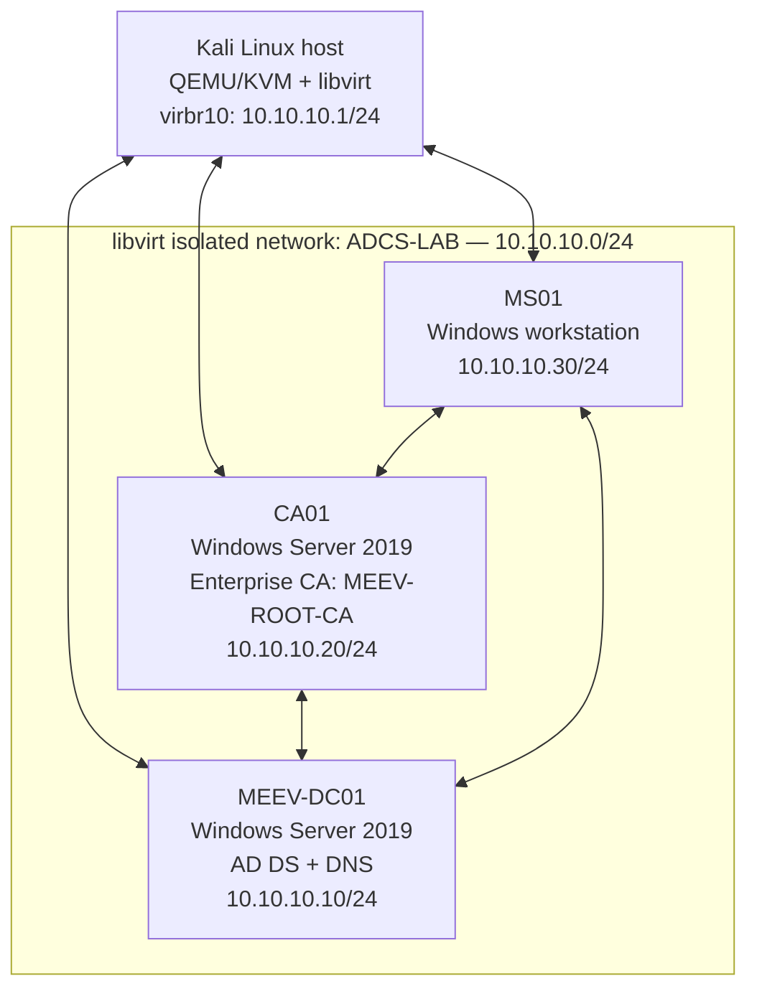

# AD CS Attack-Path Lab — Architecture

## Purpose

This document describes the architecture for an isolated Active Directory Certificate Services (AD CS) security laboratory. The topology is a design baseline; it must be updated if the implementation differs.

## Logical Topology

Kali is the host operating system and uses the libvirt bridge `virbr10` to communicate with the lab guests. It is not a guest VM in this initial design. All lab VMs use the same isolated libvirt network, `ADCS-LAB`.

## IPv4 Address Plan

Subnet: `10.10.10.0/24`  
Subnet mask: `255.255.255.0`

| System | IPv4 address | DNS setting | Purpose |
|---|---|---|---|
| Host-side libvirt bridge `virbr10` | `10.10.10.1/24` | Existing host DNS settings remain unchanged on other interfaces | Kali host access to the lab network |
| MEEV-DC01 | `10.10.10.10/24` | `10.10.10.10` | Active Directory Domain Services and DNS |
| CA01 | `10.10.10.20/24` | `10.10.10.10` | Enterprise Certification Authority joined to the domain |
| MS01 | `10.10.10.30/24` | `10.10.10.10` | Domain workstation for user activity and validation |

The domain is `esi-sba-meev.local`. The NetBIOS name is expected to be `ESI-SBA-MEEV`; confirm it with `Get-ADDomain`.

## Isolation and Network Rules

- Use the libvirt network `ADCS-LAB` for each lab guest's only network adapter.
- The network XML must have no `<forward>` element or contain `<forward mode='none'/>`, and must have no `<dhcp>` block.
- Do not use NAT, a bridged adapter, macvtap, or a physical interface.
- Do not attach the libvirt `default` NAT network (`192.168.122.0/24`).
- DHCP is disabled; use the static addresses listed above.
- A guest gateway of `10.10.10.1` is the isolated host bridge and must not provide internet access. Otherwise leave the gateway empty.
- Disable SPICE clipboard sharing and file transfer, and do not attach shared folders or virtiofs shares.
- Keep the network accessible only through the intended host and lab VMs. Do not enable host routing or forwarding from this network to other networks.
- This topology is isolated from the physical LAN and Internet at the guest-adapter level, but the Kali host can access the VMs by design. It should not be described as host-inaccessible isolation.

## Dependencies and Expected Communication

- MEEV-DC01 provides DNS for the lab domain and hosts AD DS.
- CA01 uses MEEV-DC01 for DNS and must be joined to the domain before configuration as an Enterprise CA.
- MS01 uses MEEV-DC01 for DNS and is joined to the domain.
- Hosts communicate within the isolated subnet. Domain joining, DNS resolution, CA configuration, and attack-path behavior remain unverified until tested and documented.

## Target Attack Path

The controlled path in `planing/attack-path.png` is:

1. Anonymous LDAP user enumeration.
2. AS-REP roasting of Mike Ross.
3. Kerberoasting of File Manager.
4. Malicious LNK on the SMB share.
5. Hash catch via Responder against Helpdesk Harper.
6. Hash crack and login to MS01.
7. ESC1 against Harry John.
8. GenericAll over MEEV Admin.
9. Hash dump and pass-the-hash to MEEV-DC01.

The build steps are in `planing/01-attack-path-build.md`. The clean baseline is `ESI-01-BASELINE`; the intentionally vulnerable state is `ESI-02-ATTACK-PATH`.

## Evidence to Capture

- QEMU/KVM VM inventory showing MEEV-DC01, CA01, MS01, and the `ADCS-LAB` network.
- libvirt network XML and `virbr10` showing `10.10.10.1/24`, no NAT/route forward (no `<forward>` or `<forward mode='none'/>`), and no DHCP.
- Each VM's NIC settings showing the same isolated network and no additional adapters.
- MEEV-DC01's verified hostname and IPv4 configuration.
- Successful DNS/domain checks after AD DS and DNS are installed.
- CA01 domain membership and verified Enterprise CA configuration.
- Attack-path evidence from the controlled build sheet.

Screenshots must be reviewed to remove credentials, personal information, and unrelated host details before being committed publicly.

## Status and Revision History

- **Phase 0:** Planned topology and IP address plan.
- **Phase 1:** Updated for QEMU/KVM, libvirt `ADCS-LAB`, `esi-sba-meev.local`, `MEEV-DC01`, `MS01`, and the target attack path.
