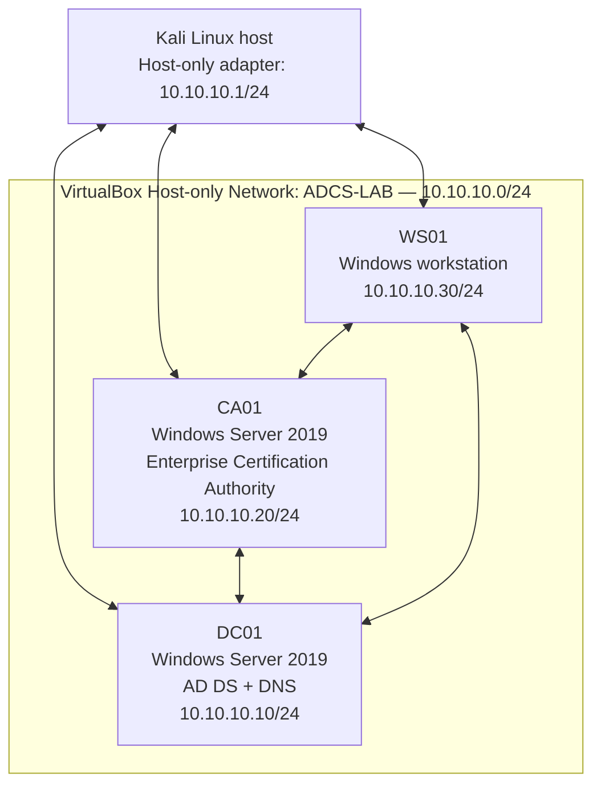

# AD CS Attack-Path Lab — Architecture

## Purpose

This document describes the planned architecture for an isolated Active Directory Certificate Services (AD CS) security laboratory. The topology is a design baseline; it must be updated if the implementation differs.

## Logical Topology

Kali is the host operating system and uses the host-only adapter to communicate with the lab guests. It is not a guest VM in this initial design. All lab VMs should use the same VirtualBox host-only network, `ADCS-LAB`.

## IPv4 Address Plan

Subnet: `10.10.10.0/24`  
Subnet mask: `255.255.255.0`

| System | IPv4 address | DNS setting | Purpose |
|---|---|---|---|
| Host-side host-only adapter | `10.10.10.1/24` | Existing host DNS settings remain unchanged on other interfaces | Kali host access to the lab network |
| DC01 | `10.10.10.10/24` | `10.10.10.10` | Active Directory Domain Services and DNS |
| CA01 | `10.10.10.20/24` | `10.10.10.10` | Enterprise Certification Authority joined to the domain |
| WS01 | `10.10.10.30/24` | `10.10.10.10` | Domain workstation for user activity and validation |

The planned domain name is `lab.example.test`.

## Why the Network Is `10.10.10.0/24` but the Host Uses `10.10.10.1`

`10.10.10.0/24` identifies the subnet; it is not an address to assign to an ordinary host. With the `/24` prefix (subnet mask `255.255.255.0`):

- `10.10.10.0` is the network address.
- `10.10.10.1` through `10.10.10.254` are usable host addresses.
- `10.10.10.255` is the broadcast address.

We assign `10.10.10.1` to the host-only adapter on Kali because it is a valid host address and is easy to remember. It is **not a gateway** in this design. The lab guests will have their default gateway field left blank, so they do not have a configured default route to the Internet or the physical LAN. The `.1` address is a convention we chose, not a requirement; another unused address in the usable range would also work.

## Isolation and Network Rules

- Use a dedicated VirtualBox **Host-only Adapter** network for each lab guest's only network adapter.
- Do not use Bridged Adapter or add NAT/NAT Network adapters to the intentionally vulnerable guests.
- Disable the host-only network's DHCP server; use the static addresses listed above.
- Leave the guests' default gateway empty unless the design is reviewed and deliberately changed.
- Disable VirtualBox shared clipboard, drag-and-drop, and shared folders for lab guests.
- Keep the host-only network accessible only through the intended host and lab VMs. Do not enable host routing or forwarding from this network to other networks.
- This topology is isolated from the physical LAN and Internet at the guest-adapter level, but the Kali host can access the VMs by design. It should not be described as host-inaccessible isolation.

## Dependencies and Expected Communication

- DC01 provides DNS for the lab domain and hosts AD DS.
- CA01 uses DC01 for DNS and must be joined to the domain before configuration as an Enterprise CA.
- WS01 uses DC01 for DNS and will be joined to the domain.
- Hosts should be able to communicate within the host-only subnet. Domain joining, DNS resolution, CA configuration, and any attack-path behavior remain unverified until tested and documented.

## Evidence to Capture

- VirtualBox host-only network settings showing the adapter address and disabled DHCP server.
- Each VM's adapter settings showing the same host-only network and no additional adapters.
- DC01's verified hostname and IPv4 configuration.
- Successful DNS/domain checks after AD DS and DNS are installed.
- CA01 domain membership and verified Enterprise CA configuration.

Screenshots must be reviewed to remove credentials, personal information, and unrelated host details before being committed publicly.

## Status and Revision History

- **Phase 0:** Planned topology and IP address plan.
- **Phase 1:** Update this document with verified implementation details and note any deviations from the plan.

