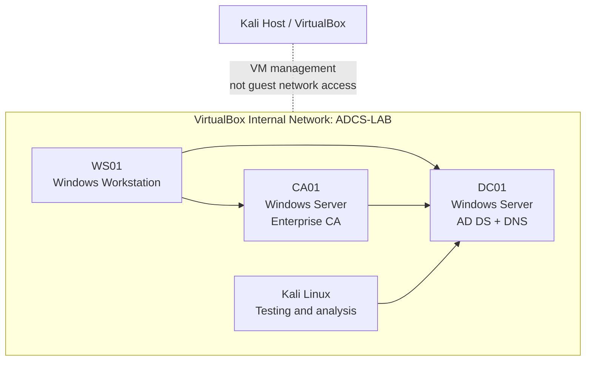

# Planned Lab Architecture

## Logical Topology

## Address Plan

| Host             | Address        | Role                               |
| ---------------- | -------------- | ---------------------------------- |
| DC01             | 10.10.10.10/24 | Domain controller and DNS          |
| CA01             | 10.10.10.20/24 | Enterprise Certification Authority |
| WS01             | 10.10.10.30/24 | Domain workstation                 |
| Kali VM, if used | 10.10.10.40/24 | Testing and analysis               |

Domain name: `lab.example.test`

## Network Notes

The topology is a design, not a verified implementation. Guest adapters will use VirtualBox Internal Network mode. The lab has no default gateway unless a later, explicitly reviewed requirement justifies one.

DNS on domain members should point to DC01. Domain joining and Enterprise CA configuration will be verified during the build.

## Revision History

* Phase 0: Initial proposed topology.
* Later revisions must record actual configuration changes and their rationale.

